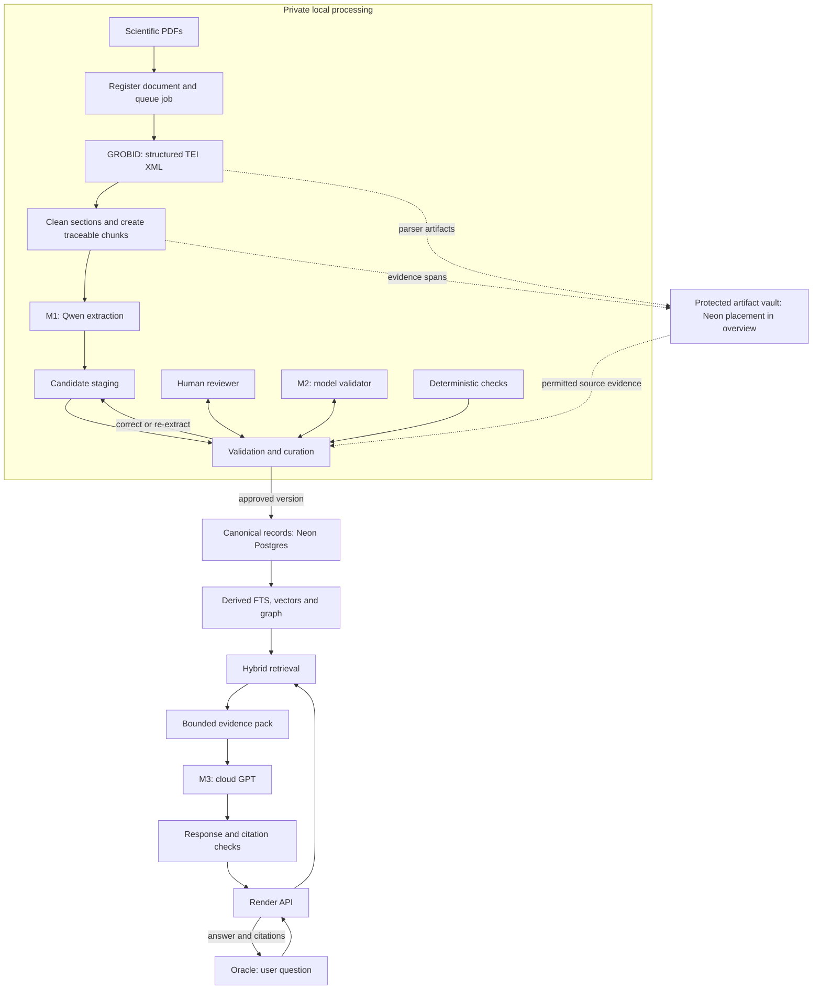
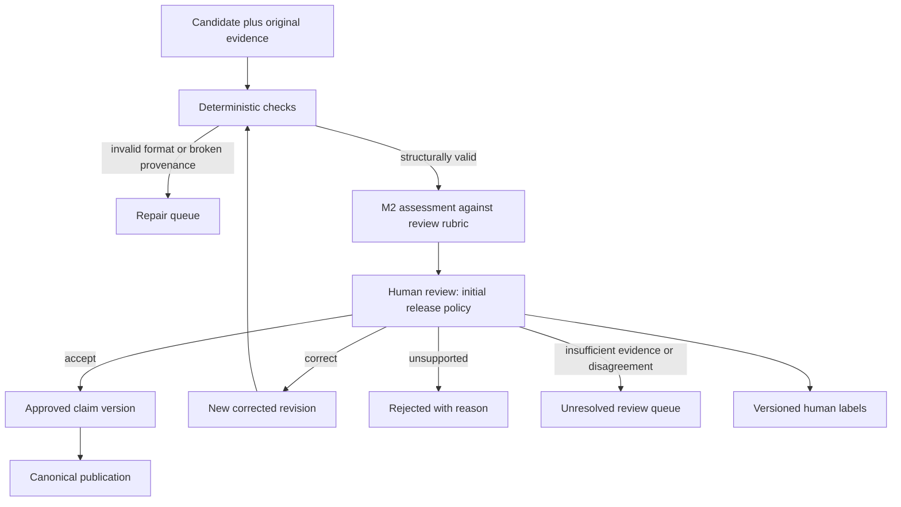
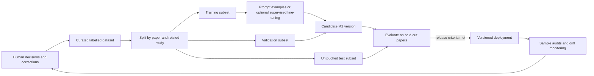

# MeatCODE architecture — ingestion and validation expanded

_Last updated: 2026-10-26 12:45 UTC · Codex / Advisory · Working design, version 0.1; awaiting Lior’s next requirements._

## Purpose and status

This document expands [the architecture overview](diagrams/MeatCODE-Architecture-Clean-Arrows.png). It explains what passes between components, what each component decides, and how human review can gradually support automated validation. It is a design specification, not evidence that the complete pipeline has been implemented.

**Confirmed by Lior:** M means an LLM role. M1 is **Qwen** (the model family name), operating in a private local environment on a PC. M2 combines human validation with a model that learns from human-labelled examples. Begin with human validation and progressively reduce routine manual review. M3 remains the previously selected cloud GPT reasoning role. Exact model variants and M2 training method are not selected here. Local-PC placement is user-reported, not independently checked in this session; older workspace snapshots describe a different configured extraction model.

**Recommendation:** label the complete middle component **“Validation & curation”**, containing **M2 — model validator**, **human review**, and **deterministic checks**. The humans and rules are not themselves M2 or LLMs. This preserves the three-model naming while showing the real architecture.

## 1. Expanded overview

Solid arrows carry records or invoke processing; dashed arrows supply stored artifacts/evidence. The M2 training loop below is separate from this operational flow. The overview’s direct M3-to-Oracle arrow is shorthand: the server controls the response. A future interactive UI can expand these same numbered sections without altering the overview.

## 2. Ingestion: PDF to evidence-bearing candidates

| Stage | Input → output | Important behaviour |
|---|---|---|
| Register and queue | PDF → document ID, file hash, access class, processing job | Detect duplicate versions; record failures and allow retries. This runs asynchronously, outside an Oracle question. |
| Parse | PDF → GROBID TEI/XML, metadata, sections and references | Check parse quality; image-only scans need an OCR path before parsing. Preserve the original and identify OCR derivatives. |
| Prepare evidence | TEI → scientific sections and chunks with stable locators | Separate bibliography, affiliations and body. Keep headings, table context and captions where interpretable. Do not treat a reference-list mention as a scientific result. |
| M1 extraction | Chunk + extraction schema/instructions → proposed entities and claims | Extract what the passage says; retain uncertainty and missing values. Do not silently supply experimental conditions from model knowledge. |
| Candidate staging | Model output → versioned candidate records | Keep the source output and parsed candidate separately. An extracted edge is not yet an approved scientific assertion. |

GROBID’s full-text service returns TEI covering the header, body and bibliography; supported coordinate options can help locate evidence. It is not a scientific fact validator. [Official GROBID service documentation](https://github.com/grobidOrg/grobid/blob/master/doc/Grobid-service.md).

Chunk boundaries need not match model context windows. The aim is to preserve a claim and enough neighbouring context to interpret it. If an abbreviation, table header or experimental condition lives elsewhere, attach that context with its own locator. Keep the extraction input reproducible.

### Where LightRAG fits

LightRAG supplies extraction, graph/index construction and retrieval machinery; it is not another model. Qwen supplies the language-model inference used for M1. The proposed human/M2 approval workflow is an additional MeatCODE layer, not something established merely by running LightRAG.

Use an isolated candidate graph or extraction staging area before publishing accepted records to the serving index. This may require a wrapper or source-level adaptation, depending on the pinned LightRAG version; this document does not claim a ready-made approval hook. Preserve individual claims and evidence before any graph description merging. LightRAG exposes extraction configuration and graph merge behaviour, but configuration alone does not implement scientific adjudication. [Official LightRAG repository](https://github.com/HKUDS/LightRAG).

## 3. What exactly is validated?

The primary unit should be a **claim with its evidence and experimental context**, rather than an entire paper or an unqualified edge. Entity identity and document quality are additional review units.

Proposed candidate contract—not a database migration:

| Field group | Required information |
|---|---|
| Identity | Candidate ID, revision, paper ID, document hash/version, extraction run |
| Evidence | Exact passage or protected reference to it; section/chunk locator; page or coordinates when available |
| Claim | Subject, predicate, object; original names and proposed canonical IDs; direction and negation |
| Conditions | Matrix, temperature, duration, pH, measurement method, quantities/units and uncertainty where reported; otherwise null |
| Interpretation | Direct reported observation, author interpretation, or proposed cross-paper inference—kept distinct |
| Review | Decision, field-level correction, error codes, reviewer, timestamp and rubric version |
| Lineage | M1 version, prompt/schema versions; M2 version if used; predecessor/superseded candidate |

**Validation has separate meanings:** extraction fidelity asks whether the paper says this; study-quality assessment asks how much trust to place in the reported evidence; cross-paper comparison asks whether studies are comparable. A faithfully extracted claim can come from a weak study. Do not collapse these into a single “true” score.

Hypothetical review example, not a chemistry claim: a candidate says “treatment increased compound X,” but the passage reports an increase only in matrix A at a specified temperature. The correction adds those conditions; it does not reject the whole paper or generalize the result to every matrix.

## 4. Validation & curation: three cooperating layers

**Layer A — deterministic checks.** Validate required fields, data types, allowed relation types, valid document/span references, numeric parsing, unit representation and duplicate identifiers. A matching quote alone does not establish that the quote supports the claim. Rules can reject malformed candidates; they cannot settle all scientific meaning.

**Layer B — M2 model assessment.** Give the model the original evidence, candidate and rubric. Request structured findings for entity identity, claim support, direction, negation, numeric fidelity, missing conditions and possible overgeneralization. Require `supported`, `unsupported` or `insufficient_context` per relevant dimension, with evidence references. Model explanations help inspection but are not proof. Self-reported confidence is not a calibrated probability of correctness.

**Layer C — human adjudication.** Initially, a human approves every record admitted to canonical knowledge. The reviewer sees evidence beside the candidate, can edit fields, and records reasons. Provide `accept`, `correct`, `reject` and `defer`; use a second reviewer to adjudicate difficult disagreements and a subset to measure consistency. M2 may run in shadow mode, but cannot overrule the human.

Avoid having M1’s own explanation substitute for the source. An alternative model or different prompting can help investigate correlated errors, but using two models does not guarantee independent or correct judgments.

## 5. How human feedback becomes a better M2

An LLM already is a neural network. Saving feedback does **not** change its weights. There are two distinct improvement routes: retrieve reviewed examples into the validator’s prompt, or explicitly train an updated model on labelled input/output examples. Both require evaluation.

Store rejected and corrected cases as well as accepted ones. Labels should capture **what was wrong**, not only a thumbs-up. Preserve the model’s original candidate, the human’s corrected target, evidence and rubric version. Resolve ambiguous labels; do not train as though reviewer disagreement were certainty.

Start by improving the rubric and using reviewed examples. Consider supervised fine-tuning only once recurring error types and sufficiently consistent labels exist. A smaller classifier may suit a narrow accept/defer task; an LLM is more appropriate when evidence interpretation and structured corrections are needed. Evaluate both against the actual task rather than choosing by size alone.

Supervised fine-tuning explicitly trains on input/output examples; TRL documents such training and optional adapter use. It is one possible implementation, not a selected dependency. Hardware needs depend on model size, context length and training configuration. [Hugging Face TRL SFT documentation](https://github.com/huggingface/trl/blob/main/docs/source/sft_trainer.md).

### Progressive automation

| Phase | Human role | Model authority |
|---|---|---|
| 1. Establish the rubric | Review all admitted records; record field corrections and disagreements | Shadow assessment or review assistance only |
| 2. Prove usefulness | Continue approval; compare M2 to held-out human decisions | Prioritize queues and suggest corrections |
| 3. Selective automation | Review uncertain, novel and high-consequence cases; audit samples of automated decisions | Auto-approve only demonstrated reliable categories under an explicit policy |
| 4. Controlled operation | Own policy, adjudicate exceptions, monitor changes and revoke releases | Handle routine eligible cases without per-record human supervision |

“Without human supervision” is achievable as a goal for routine processing, not as an assumption that governance and auditing can disappear. Do not silently train on M2’s own approvals as if they were human labels.

Before phase 3, measure false acceptance, false rejection, correction accuracy, abstention rate, fraction automated and reviewer time. Report results by relation type, numeric vs qualitative claim and document source/quality. Split by paper and related study to reduce leakage from near-identical passages. Establish thresholds with Lior and scientific reviewers; no arbitrary confidence cutoff or sample count in this document certifies readiness. Changes to M1, parser, schema or corpus can require revalidation of M2.

## 6. Publication, storage and retrieval

Keep four logical categories distinct: raw artifacts, unreviewed candidates, approved claims, and human review/training records. They may use related storage infrastructure, but need different permissions and retrieval eligibility. Rejected and deferred candidates remain available for audit or training and do not enter ordinary approved-evidence retrieval.

The selected overview places the protected artifact vault in Neon. Record an unresolved storage decision: which artifacts are stored directly in Postgres, which remain local, and whether large binary originals eventually need object storage with Neon metadata. Neon being a database does not itself resolve storage permissions, retention or access control. Preserve the selected map while documenting this implementation detail as open.

Publish approved claim revisions transactionally with provenance. Build the search/graph/vector projections from a known canonical version; record embedding-model identity and dimensions. A publication failure is retryable, not permission to insert an unreviewed result. Retractions or corrected claims must invalidate affected projections and cached answers where tracked.

Hybrid retrieval combines lexical matches, embedding similarity and bounded graph traversal. An embedding component must appear in the expanded diagram even though it is not one of M1–M3. Connect papers through canonical entities **and qualified evidence**, preserving independent claims and study conditions. Similarity is a retrieval signal, not proof of causality, contradiction or scientific support.

The Render API receives the question and allowed user context, retrieves a bounded evidence pack, calls M3 and checks the response’s citation references. The pack should include claim IDs, paper IDs, permitted passages, conditions and review state. Check that references exist and that claims are supported; ID validity alone is insufficient. Unsupported answers should express uncertainty or abstain. A missing graph connection means “not found in this indexed evidence,” not “a confirmed gap in science.”

M3 outputs are responses or hypotheses. They must not silently become canonical facts. Any proposed new assertion returns through a separate evidence and review workflow.

## 7. Changes recommended for the expanded visual

1. Keep the supplied overview as page one, with M1 labelled “Qwen · local PC.”
2. Expand PDF → GROBID → M1 to expose the job queue, optional OCR, section cleaning and traceable chunking.
3. Replace the single M2 shield at detail level with the three validation layers and a candidate staging area.
4. Add a distinct dotted learning loop: human labels → dataset → training/evaluation → released M2. Do not draw human feedback directly into a model as if learning were immediate.
5. Expand Neon into artifacts, candidates, approved claims and review history; show graph/vector indexes as derived projections.
6. Show embedding generation and the server-mediated answer return path. Replace “Neon stores truth” with “Neon stores approved, traceable evidence.”

The next discussion should define the first human review unit and rubric. Recommended starting unit: one extracted claim plus source passage and experimental conditions. Lior’s further explanation may change that choice; this draft deliberately leaves reviewer assignment, exact schema, thresholds, model variant and training schedule open.

## References and evidence boundary

The supplied image and Lior’s current description define the intended architecture. Existing local documents consulted: `ENGINEERED_RAG_ARCHITECTURE.md`, `LIGHTRAG_CURATION_AND_SCALING.md`, `PROJECT_STATE.md` and coordination files. Historical implementation snapshots are not proof that the proposed M2 pipeline exists. Official upstream references above were consulted on 26 October 2026. No model training, extraction, schema change or deployment was performed for this document.
