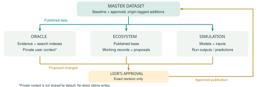

# MeatCODE — governed datasets and permissions

_Last updated: 29 October 2026 · Data/Advisory · Permissions and module architecture; provisioning pending._

**Flow:** Master → approved module copies → child contributions → Lior's review → master → affected modules. No child has credentials to write directly into the master. Tags record origin; your approval controls admission.

## Components and collaborators

- **Master / Lior:** Owns the shared record, access policy, backup recovery and final approval. Existing records are tagged as the baseline at migration; baseline does not mean scientifically verified. New contributions retain their component, project, contributor and source identity.
- **Oracle / Lior:** Reads published scientific evidence and maintains its own derived indexes and private user context. Proposed scientific additions enter the review queue. Personal memory, prompts and feedback do not become shared scientific knowledge by default. Additional collaborator not assigned.
- **Ecosystem / Yochai; Lior owner:** Yochai can read its published base and add/edit working ecosystem records. He submits changes for your review; cannot modify the master, sibling datasets, shared base or permissions.
- **Simulation / Lior owner; Pablo proposed collaborator:** Stores models, inputs and run outputs. If assigned, Pablo can contribute simulation records within this component. Predictions remain labelled predictions and require your approval before entering shared knowledge. No new account grant until collaborator assignment is confirmed.
- **Review / Lior only:** Sees added, modified and withdrawn records with before/after differences and provenance. Approves or rejects a specific immutable revision. A later edit requires fresh approval; rejected or pending records never propagate.

## Roles and permissions at a glance

| Role | Read scope | Edit / submit | Approve master | Publish / manage access |
| --- | --- | --- | --- | --- |
| Owner / Lior | Master + modules | Manage records; child changes still reviewed | Yes, exact revision | Authorize publication; manage access |
| Contributor | Assigned module | Working records; submit revisions | No | Neither |
| Viewer | Explicitly shared data | No | No | Neither |
| Publisher service | Approved revisions + required targets | Apply approved revision only | No | Publish approved version; no access management |

**Assignments:** Yochai is the intended Ecosystem contributor. Pablo (Simulation) and Daniel (viewer) are proposed, not granted. Necmettin's existing scientific read-only access is preserved. Module applications use separate credentials; no contributor gets master or sibling access.

## Data modules and approval flow

**Deployment status:** Proposed architecture and permissions. Three Neon module projects, new contributor accounts, review interface and synchronization jobs have not yet been verified live.
