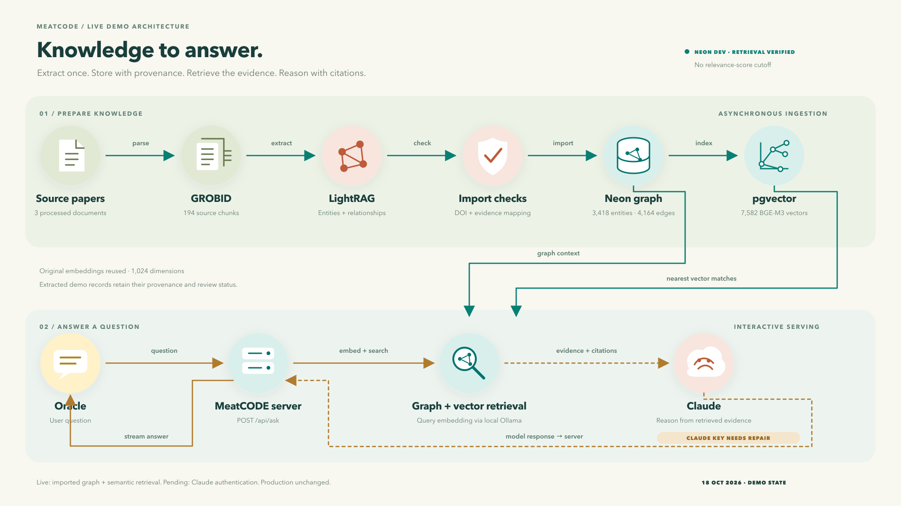

# LightRAG → Neon demo and process design

_Last updated: 2026-10-18 10:12 UTC · Codex / Data-RAG-Design · Neon import and semantic query verified; minimal diagram; Claude credential repair pending._

## User direction

On 18 October Lior explicitly removed the Oracle's provisional relevance-score threshold and
requested use of the already extracted LightRAG graph, imported with pgvector into Neon, for a
demonstration. This supersedes the threshold/corpus restriction described earlier in the benchmark
protocol. Scores remain stored for future work; they no longer exclude sources from Oracle FTS.
Lior subsequently clarified that the requested design is the **architecture and process diagram**.

## Design



- [Interactive diagram viewer](diagrams/meatcode-rag-demo-flow.html): overview, ingestion, query, benchmark views.
- [Minimal overview SVG](diagrams/meatcode-rag-demo-overview.svg).
- [Presentation PNG](diagrams/meatcode-rag-demo-overview.png).
- [Detailed flow SVG](diagrams/meatcode-rag-demo-flow.svg).

The upper flow builds knowledge asynchronously: GROBID/LightRAG extraction → source and evidence
checks → Neon graph → pgvector. The lower flow answers a question: Oracle → server → query
embedding and evidence retrieval → hosted answer model → streamed cited answer back to Oracle.
The benchmark is separate and omitted from the minimal overview. Teal arrows carry knowledge;
gold arrows carry the live request/response. Dashed gold connectors identify answer generation
awaiting Claude credential repair. Every arrow has a named payload or action. The diagram uses
verified corpus counts and distinguishes working graph/vector retrieval from the currently failing
answer-model authentication. It follows the latest Architecture chat's icon-led style, with no
component-card borders or permanent benchmark panel.

| Connector | What moves |
|---|---|
| Extract → check/map | Candidate entity/relation descriptions, original vectors and source chunk references |
| Check/map → Neon | Structurally validated demo records with exact DOI/source mapping and extracted status |
| Neon graph → vector index | Versioned descriptions and their matching embeddings; this import reuses existing vectors |
| Graph → retrieval | Seed entities, connected relations and item-to-chunk-to-paper provenance |
| pgvector → retrieval | Nearest entity/relation IDs and cosine scores for the embedded user query |
| Oracle → server | User question and permitted context |
| Server → retrieval | Search request; local Ollama produces the compatible query vector |
| Retrieval → hosted model | Bounded extracted evidence with real Neon source IDs and answer instructions |
| Hosted model → server | Generated answer text |
| Server → Oracle | SSE answer chunks and source metadata; the browser does not contact Neon or the model directly |

The demo copies the existing BGE-M3 vectors into pgvector. In steady-state ingestion, changed or
new admitted descriptions are embedded asynchronously. The model roles in the target architecture
(Qwen extraction, independent validation, hosted GPT reasoning) remain distinct from the existing
Oracle's Claude generation configuration. This change does not switch the answer provider.

## Implemented locally

1. Removed `ORACLE_MIN_RELEVANCE` and the `relevance_llm` predicate from Oracle retrieval and
   both current evaluation runners. FTS still requires an indexed source and a nonzero query match.
   Updated Papers browser's Oracle-eligibility predicate, labels, mock behavior and obsolete lenses.
   Optional user-selected numeric score filters remain available in the papers browser.
2. Added migration `0015_lightrag_demo_pgvector.sql`: additive `lightrag_demo` schema, pgvector,
   graph tables, original embedding-input text/hash, provenance joins and HNSW/FTS indexes.
3. Added `pipeline/import_lightrag_demo.py`: default mode validates without network/writes;
   `--apply` uses one transaction, exact DOI→source matching, foreign keys, manifest/count checks,
   idempotent immutable batches, and a transaction advisory lock. It never mutates `sources`,
   `molecules`, or existing scientific claims. Existing extracted descriptions remain demo assertions.
4. Added dev-only `server/lightrag_retrieval.py`: 1,024-dimensional query embedding through local
   Ollama, cosine retrieval from Neon pgvector, one-hop relationship expansion, bounded derived
   evidence and real Neon source IDs. It checks current embedding compatibility against an original
   stored input/vector (cosine ≥0.99) before vector queries because the historical model digest is
   unknown. A mismatch/service failure is explicitly reported as lexical-graph fallback.
5. Connected the dev Oracle to this adapter when a batch exists. Until import succeeds, the existing
   FTS path remains usable, without a score cutoff. `ORACLE_GRAPH_DEMO=0` restores FTS in dev.
   Production does not enable the demo adapter. The additive SSE `retrieval` event exposes mode,
   batch, retrieval status and evidence IDs; the existing frontend can ignore it safely.
6. Added authenticated dev-only `GET /api/kg-demo/status` and
   `GET /api/kg-demo/search?q=...`. The normal Oracle continues to use `POST /api/ask`.
   Graph demo responses use extracted descriptions; no raw PDF/TEI/source passage text is uploaded.
   The source-linked metadata represents 194 chunks, with their raw text retained locally.

## Verified locally

The importer successfully decoded and checked the original base64/zlib/Float16 vectors, validated
dimensions/nonzero finite values, reconciled every vector with a graph entity/edge, checked every
evidence reference, verified processed-document membership, and confirmed snapshot hashes stayed
unchanged during preparation.

| Record type | Prepared count |
|---|---:|
| Processed source documents | 3 |
| Chunk metadata records | 194 |
| Entities | 3,418 |
| Relationships | 4,164 |
| Entity/relation embeddings | 7,582 |
| Item-to-chunk evidence links | 8,932 |

Batch ID: `lightrag-0fea952f5db82becdc87501f`. Source DOIs previously matched Neon dev
records 275, 833 and 857. Their stored scores are preserved and no longer used as an Oracle cutoff.
Three failed documents are excluded. No raw chunk text is copied into the prepared database payload.

Thirteen unit tests pass, covering original vector decoding, invalid embeddings, model mismatch,
score-filter removal, evidence budgeting, explicit lexical fallback/graph expansion, missing import,
transaction boundaries, SSE completion/truncation and frozen benchmark packets. Python compilation
and Papers browser JavaScript syntax checks pass. The diagram is rendered and visually inspected.

## Live verification and next action

**Applied and verified in Neon dev.** Automatic approval review initially failed with an account
usage-limit error; later requests through the same required approval route succeeded. No bypass
was used. The importer returned `imported`, then `verified_existing` on the second invocation,
with identical counts. All schema/import work committed atomically.

`/api/health` reports a working database connection; `/api/kg-demo/status` reports the imported batch.
The question “How does protein binding affect flavor release?” returned `mode=vector_graph`,
15 evidence items, source 275 and no embedding issue. The first measured search took 2.43 seconds.
The `/api/ask` request also retrieved graph evidence successfully (725 ms measured retrieval),
but answer generation failed with Anthropic `401 authentication_error: invalid x-api-key`.
The separate LightRAG credential also failed a small validation request. Neither key was printed
or modified. Lior explicitly chose **Keep Claude; I’ll repair its credentials**. No local-Qwen
fallback or answer-model switch was introduced. These attempts are not benchmark scores.

The server is running at `http://localhost:8000` against Neon dev with the graph adapter enabled.
The remaining action is to repair the Anthropic credential in root `.env` or the intended nonempty
dev override, restart the local server, and repeat one `/api/ask` check. Do not paste a key into chat.
Production code/configuration/data remain unchanged.

On Lior's Mac, the concrete import command is:

```sh
python3 pipeline/import_lightrag_demo.py --workspace /Users/lior/LightRAG --env-file .env.dev --apply
```

Run it from the MeatCODE repository. It prints only verified counts, source IDs and batch ID on
success. A failure rolls back the transaction; it does not leave a partial import. It defaults to
the dev database and never prints the connection string.

For an import followed by the local Oracle, use `Release Center/demo-lightrag.command`.
Ollama must be running with `bge-m3:latest` available for semantic search. If unavailable, the
retrieval status explicitly identifies lexical-graph mode. The current answer model still requires
the existing Anthropic key. The script does not install packages or publish/deploy anything.

Completed checks: inspect `/api/kg-demo/status`, verify counts against the table above, query
`/api/kg-demo/search?q=protein%20flavor%20binding`, inspect source/chunk links, and submit the
same question through `/api/ask`. Semantic mode and idempotency passed. A generated answer is
pending credential repair. Full answer correctness, latency and comparative quality must be
evaluated after that repair; no successful full-answer result is claimed.

Rollback of the demo needs only `ORACLE_GRAPH_DEMO=0` to restore FTS; imported records can remain
for inspection. Any batch deletion must be deliberate, in foreign-key order, and restricted to its
batch ID; this session supplies no destructive automatic rollback. Production schema/data and
deployment are unchanged. Lior publishes local code through the existing dev release process.

## Self-service schema procedure

The migration can be inspected in Neon SQL Editor or a PostgreSQL client before execution. It
enables `vector`, creates a dedicated schema/tables/indexes, and uses a transaction. No existing
columns or views are removed, so no drop/dependency rebuild is needed. Prefer the importer for this
demo because it verifies the complete batch before committing, and records the original embedding
inputs with their provenance. Schema rollout to production is a separate release step after dev
verification; no production demo import has been attempted.
