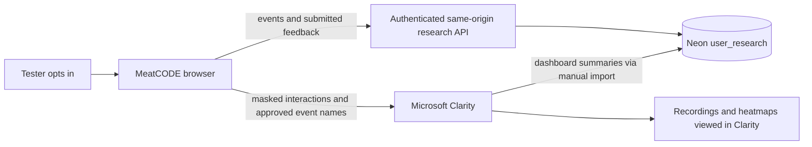

# MeatCODE user testing — Clarity and first-party research storage

> Current 29 October release: [isolated research branch and development production-monitoring dashboard](RESEARCH_JOURNEY_OPERATIONS.md). New demo sessions start automatically after login per Lior’s latest instruction; earlier optional-only and shared-schema descriptions below are historical.

## Oracle transcript extension — 29 October 2026

Current implementation: [private Oracle chat capture](ORACLE_CHAT_RESEARCH.md). Separate, unchecked full-chat opt-in supersedes the historical metadata-only scope below. Questions and answers stay in Neon and remain masked in Clarity. Publication and verification are recorded in the extension guide.

## Deployment update — 29 October2026

Lior explicitly authorized publishing this release and separately approved enabling the private dashboard. Clean-checkout release20acea3e648e was published to dev, verified live with user_testing enabled, then promoted to main with rollback tagprod-20261029-analytics-live-testing. Render deployment verification is recorded in data/verification/research-deployment-2026-10-29.json; final production status must come from that record, not the historical preparation text below.

USER_RESEARCH_ENABLED=true and distinct RESEARCH_ADMIN_TOKEN credentials are saved on both Render services. The private dashboard at /research-dashboard requires the normal site login, then the corresponding research-admin value from that service's Render Environment settings. Do not paste it into chat or a URL. The dashboard keeps it in page memory. Local ignored .env/.env.dev retain the matching values. No site password, Anthropic key or provider API secret was changed.

Environment API updates also triggered Render redeployments of their then-current source. Earlier wording that they did not trigger deployment is corrected here; those old-source redeployments did not install missing tracking code. The new Git source release does.

Earlier preparation notes below are historical. Production capture and Microsoft recording delivery require a signed-in tester's fresh opt-in; they are not proved by public health or code publication.


_Last updated: 2026-10-28 15:50 UTC · Project Coordinator · initial integration and operations handoff; publication status below._

## 29 October update

The live Clarity installation check found both hosted services still running6394c039749a, without this integration. PostHog integration, runtime settings and a six-chart private native dashboard are now prepared. The local Neon dashboard refreshes every three seconds. Consent renews to2026-10-29 through migration0017 already applied on both branches. See [current PostHog and live dashboard handoff](POSTHOG_LIVE_TESTING.md) and [Clarity installation diagnosis](CLARITY_INSTALLATION_CHECK_2026-10-29.md). Application publication and hosted provider verification remain necessary. The Oracle401 logs below are dated28 October12:39 UTC; a later manual deployment occurred16:36 UTC, so they do not prove the latest credential status.

## Current outcome

The public Clarity project ID supplied by Lior is **z4upnrbddu**. The browser integration is built locally, alongside consent controls and explicit feedback. The additive `user_research` schema has been applied to both the dev and production Neon databases. Its records are separate from scientific evidence, entities, relations and embeddings. The existing scientific/public table inventory was verified unchanged.

Application code is **not yet published**. Clarity is not claimed active on either hosted site by these local edits. The new release flag `user_testing` is enabled in the prepared dev/prod configuration, but the browser loads no SDK and sends no testing events until a tester explicitly opts in. `USER_RESEARCH_ENABLED=false` is an environment emergency stop; it overrides an enabled release flag. Missing database configuration also disables capture. Session deletion remains available when capture is disabled.

Original production has a separate unresolved Claude credential problem. Fresh logs on28 October at12:39:19/22 UTC show 401 authentication_error invalid x-api-key. A key is present; its active value is rejected. The original service is [MeatCODE](https://dashboard.render.com/web/srv-d96ftplaeets73da7vng/env), serving meatcode-oracle.onrender.com; the working dev service is dev-meatCODE, serving meatcode.onrender.com. They do not share environment updates. The new source skips local dotenv files on Render so they cannot overwrite dashboard credentials; this does not make an invalid key valid and is not active until deployment.

## How the bridge works



Clarity handles replay and heatmaps in its dashboard. Its documented Data Export API returns aggregate dashboard metrics, not a full download of raw recordings. Our importer accepts numeric metrics and Browser/Device/OS dimensions; it excludes URL/title/referrer metrics and arbitrary strings. **The shared-project export covers the whole Clarity project**, including both domains if both are recording. The export row's environment is the destination/import context, not proof of a filtered traffic cohort. Use the production importer as the single shared-project collection point; use Clarity's dashboard environment/scene tags to inspect individual cohorts. A separate project would be needed for fully independent exports.

The first-party API receives only a random browser-tab session ID, random event IDs, allowed scene names, timing, source count and categorical outcomes. It does not receive prompts, answers, attachments, user names, emails, IP addresses or arbitrary JSON properties. Consent is tab-scoped; it does not identify a person across devices. No first-party session UUID is sent to Clarity as an identifier because it also acts as a deletion capability. Own feedback and Clarity recordings are not linked one-to-one by this release.

A tester can submit a rating, category and optional comment using **Testing privacy**. Only that deliberately submitted comment is stored as first-party text. It is not forwarded as a Clarity event/tag. These comments are operational research input, not scientific evidence and not automatic model-training data.

## What is stored and where to see it

In Neon, select the intended database branch, open **Tables**, and choose the **user_research** schema:

| Table | Contents |
|---|---|
| sessions | Anonymous tab ID, environment, consent version and timestamps |
| events | Allowlisted navigation and Oracle lifecycle outcomes; optional duration/source count/error category |
| feedback | Explicit rating, category and optional comment |
| withdrawals | Minimal tombstone preventing queued requests from recreating a deleted session |
| clarity_exports | Sanitized aggregate snapshots with project, capture window, status and import timestamp |

No public endpoint lists sessions or comments. Shared scientific database backups exclude the research schema. Private JSONL exports cannot be downloaded through static GET/HEAD routes, including encoded paths, traversal and symlink aliases. PUBLIC has no schema/table grants; the configured application database role can write through the gated API. This is schema separation inside each existing database, not a new paid database or an independently credentialed storage service.

Example read-only query in Neon SQL Editor:

```sql
SELECT environment, name, count(*) AS events
FROM user_research.events
WHERE created_at >= now() - interval '7 days'
GROUP BY environment, name
ORDER BY environment, name;

SELECT created_at, environment, rating, category, comment
FROM user_research.feedback
ORDER BY created_at DESC
LIMIT 100;
```

These are opt-in, best-effort browser measurements. Blockers, disconnections and disabled consent affect counts. HTTP200 alone is not an Oracle success: the client records SSE errors as failures and suppresses a later completion for the same failed turn. Source count is retrieval context, not answer-quality evidence. Feedback refers to the tester's experience/session, not a stored question/answer pair.

## Activation and verification

1. Reconcile the local checkout with current remote main before publication. The local checkout lacks newer Science/Ecosystem/guided Oracle work. Use the narrow reviewed patch package; do not replace newer remote files wholesale.
2. Lior publishes through the repository's existing dev → staging → production Release Center workflow. The project ID is public configuration. No private export token is needed for browser recording.
3. In Clarity project settings, enable **Consent Mode** for the intended regions and verify masking. The application also masks the whole body before loading the SDK, denies advertising storage, and does not load the SDK on routes with query parameters or unrecognized hashes. It will not load if an unmask override is present. See [ConsentV2](https://learn.microsoft.com/en-gb/clarity/setup-and-installation/clarity-consent-api-v2) and [masking](https://learn.microsoft.com/en-us/clarity/setup-and-installation/clarity-api).
4. On staging, decline testing first: no Clarity tag/collect requests or first-party events should occur. Then explicitly opt in, navigate between modules and submit one Oracle question and one feedback item. Verify the corresponding research rows and Clarity dashboard session/custom events. Actual recording delivery must be confirmed after publication; local browser fixtures do not prove it.
5. Test **Stop testing & delete session data**. Our first-party session/events/feedback are deleted, pending requests cannot recreate them, and future collection stops. Deleting already-uploaded Microsoft recordings is separate and managed in Clarity; this action does not claim to erase Microsoft's copies.
6. Verify production separately after promotion. Restore Claude with a valid key on the original production service, choose **Save and deploy**, and confirm a real signed-in answer. Health reports configuration presence only, not valid model authentication.

## Aggregate import and maintenance

The private Clarity export token is optional and must be placed in secure runtime/local configuration as `CLARITY_EXPORT_TOKEN`; never put it in chat, frontend code or committed files. Obtain it in Clarity **Settings → Data Export**. The current [Microsoft export limits](https://learn.microsoft.com/en-us/clarity/setup-and-installation/clarity-data-export-api) are ten requests/project/day, the previous one to three days, at most three dimensions and 1,000 unpaginated rows. Our application guard is database-local; Microsoft's quota is project-wide, including other consumers.

Manual preview, with no Microsoft request:

```sh
python3 pipeline/user_research/clarity_import.py --environment prod --days 1
```

Import when the token is securely configured and the project has real data:

```sh
python3 pipeline/user_research/clarity_import.py --environment prod --days 1 --apply
```

Export first-party testing records privately as JSONL (defaults under ignored data/user_research; optional explicit dates/output):

```sh
python3 pipeline/user_research/manage.py --environment prod export
```

Preview90-day cleanup, then apply it deliberately:

```sh
python3 pipeline/user_research/manage.py --environment prod purge
python3 pipeline/user_research/manage.py --environment prod purge --apply
```

**No import or retention schedule was created.** Ninety days is the chosen policy; the maintenance command must be run or scheduled before promising automatic expiry. Database deletion does not delete separately downloaded exports; manage those under the same policy. Clarity controls retention of its own recordings independently.

## Implementation and boundaries

Browser: app/assets/user-research.js and small lifecycle hooks in app/meatcode_mockup.html. HTTP: server/research_http.py plus authenticated routing in server/meatcode_server.py. Storage: server/user_research.py and db/migrations/0016_user_research.sql. Operations: pipeline/user_research/. Plan: .telemetry/.

The HTTP boundary rejects oversized/incorrectly framed bodies, unsupported fields, cross-origin requests and unexpected event types. It requires JSON, a custom same-origin header and the existing site gate; capture requests are bounded. Withdrawals are not blocked by the capture switch or capture-rate limit. Inserts are idempotent; transactional session locking and tombstones prevent deletion races. Errors returned to the browser contain no SQL or submitted text. No schema/read-all/administrative capability is exposed to testers.

No model/key/provider change, Git/commit/promotion, hosted activation or paid model test was performed by the agents. No actual Clarity export was made without a token. See `platform_docs/user_research_2026-10-28/` for combined source checks, independent live schema checks, a local HTTP-to-Neon verification and the privacy-dialog screenshot. Both schemas currently contain zero research rows after test cleanup.
